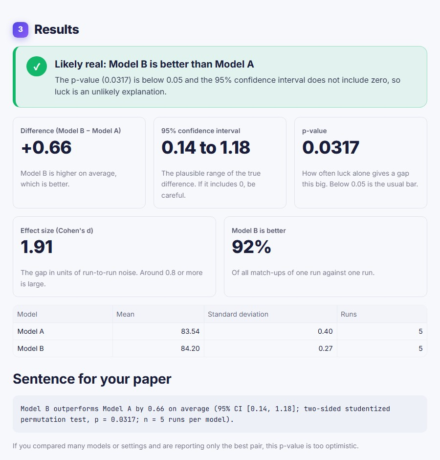
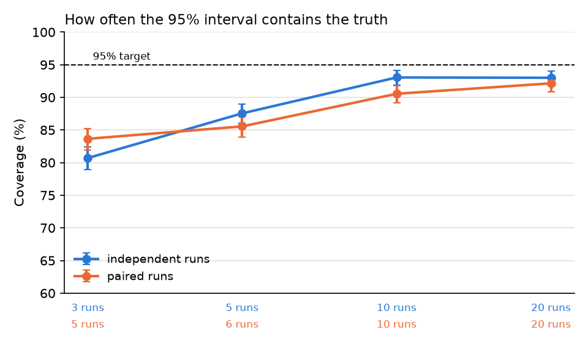
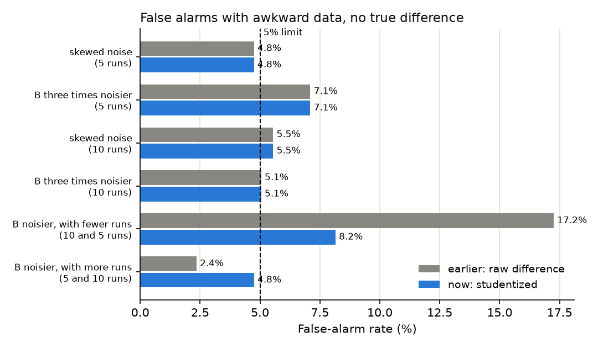

# easyCI

**Is your model's improvement real, or just luck?**

easyCI is a small web app for machine-learning researchers. You give it the
results of two models, and it tells you how much of the difference between
them you can trust: a confidence interval, a p-value, a plain-language verdict,
and a sentence you can paste into a paper.

**Try it online: [easyci-itaiwachtel.streamlit.app](https://easyci-itaiwachtel.streamlit.app)**
(no installation; the built-in examples show every feature).



## The problem

"Our model reaches 84.2% and the baseline 83.7%" is not, on its own, evidence
of an improvement. Training is random: the same model trained again with a
different random seed gives a different score, and a test set is only a sample
of the examples a model could meet. A gap of half a point can be a real gain
or pure luck, and the two look identical in a results table.

The statistics that tell them apart are well known but easy to get wrong:
choosing the wrong test for the data, treating paired runs as independent, or
reading a p-value above 0.05 as proof that two models are equal. easyCI
chooses the right method for the data you have and explains the result.

## What it does

easyCI has two modes, depending on the results you have.

### Several training runs per model

You trained each model several times with different seeds and have one score
per run. Paste the scores or upload a CSV file, and say whether both models
used the same seeds.

| Input | Output |
|---|---|
| A: `83.1, 83.9, 83.5, 84.0, 83.2`<br>B: `84.2, 83.8, 84.5, 84.1, 84.4` | **Likely real: B is better than A.** Difference +0.66, 95% CI 0.14 to 1.18, p = 0.0317. |

You also get the effect size, how often one model beats the other, two plots,
and a calculator that estimates how many runs you need to detect a difference
of a given size.

### One run per model, results per test example

You trained each model once and know, for every test example, whether each
model answered it correctly. Upload a CSV file with one row per example.

| Input | Output |
|---|---|
| 1,000 test examples; A is right on 835, B on 850; they disagree on 85 | **No evidence of a difference.** Difference +1.50 points, 95% CI −0.30 to 3.30, p = 0.128. |

### In both modes

- **A verdict:** "likely real", "borderline" or "no evidence of a difference",
  with the reason. The last one is worded on purpose: a large p-value does not
  prove two models are equal, it means the data cannot tell them apart.
- **Cautions about your data**, for example: "With 5 paired runs, the p-value
  can never go below 0.0625, so no result could pass the 0.05 bar."
- **A sentence for your paper** that states the effect, the interval, the test
  and the number of runs.

## The methods

| Your data | p-value | Confidence interval |
|---|---|---|
| Several runs, independent seeds | Studentized permutation test | Welch t-interval |
| Several runs, shared seeds (paired) | Sign-flip permutation test | Paired t-interval |
| One run, right/wrong per test example | McNemar's exact test | Bootstrap over examples |

- **Permutation tests** answer "if the two models were identical, how often
  would shuffling the results give a gap this big?". They make no assumption
  about the shape of the noise. When the number of possible shuffles is small
  the test tries all of them and the p-value is exact.
- **The t-interval** widens when runs are few, to make up for the noise itself
  being estimated from little data.
- **McNemar's test** looks only at the test examples on which the two models
  disagree, and asks whether their split is more lopsided than coin flips.
- **Wilson intervals** are used for each model's accuracy, because the textbook
  interval breaks for small test sets and accuracies near 100%.

Every method is written out in plain numpy in the [`stats`](stats) folder and
checked against scipy's implementation in the tests.

## Validation

A tool that judges other people's results should be checked itself.
[`validation/simulate.py`](validation/simulate.py) generates fake results from
models whose true difference is known, runs easyCI on them, and counts how
often easyCI is right. Each scenario is repeated 2,000 times.

Three properties are measured:

- **False-alarm rate:** when the true difference is zero, how often the
  p-value is below 0.05. It should be at most 5%.
- **Coverage:** how often the 95% confidence interval contains the true
  difference. It should be 95%.
- **Power:** when there is a true difference, how often it is detected.

### What the validation found, and what changed

The first version of easyCI used a percentile bootstrap interval and a
permutation test on the raw difference of means. The simulation showed two
problems with it.

**1. The confidence interval was too narrow.** Labelled 95%, it contained the
truth only 81% to 93% of the time with 3 to 20 runs. easyCI now uses a
t-interval, which is on target.



| Runs per model | Independent, before | Independent, now | Paired, before | Paired, now |
|---|---|---|---|---|
| 3 | 80.7% | 96.9% | | |
| 5 | 87.5% | 95.5% | 83.7% | 95.2% |
| 6 | | | 85.5% | 94.8% |
| 10 | 93.0% | 95.3% | 90.5% | 95.0% |
| 20 | 93.0% | 94.8% | 92.2% | 94.8% |

**2. The test raised too many false alarms when one model was noisier and had
fewer runs.** With 10 runs against 5, the 5 being three times noisier, the
false-alarm rate was 17.2% instead of 5%. Studentizing the test (comparing the
difference divided by its standard error across shuffles) brought it to 8.2%.



The earlier methods are still in the code, marked as such, so the simulation
measures old and new on exactly the same fake data.

### What held up from the start

- **False alarms with ordinary data:** 0% to 5.5% across 8 per-seed scenarios.
- **Per-example mode:** false alarms 3.6% to 4.5%, coverage 94.0% to 95.7%.
- **Skewed noise:** false alarms 4.8% and 5.5%.

All results are in [`validation/results.csv`](validation/results.csv), each
rate with its own margin of error.

## Known limitations

- **Uneven noise with few runs.** When one model is more than about twice as
  noisy as the other, the false-alarm rate is above 5%: 8.2% for 10 runs
  against 5 with the smaller group noisier, and 7.1% for 5 runs against 5.
  With 10 or more runs per model and equal run counts it is back to 5%. easyCI
  shows a caution when it sees this pattern.
- **The runs-needed calculator is optimistic for few runs.** It aims for 80%
  power. It delivers 75% to 81% when it recommends 13 or more runs, but only
  66% to 72% when it recommends 6 to 8. The app says so next to the result.
- **The per-example mode compares two trained models, not two training
  methods.** With one run per model, luck in the random seed is invisible.
- **Two models only.** If you compare many models and report the best pair,
  the p-value is too optimistic. easyCI states this but does not correct for it.
- **Decimal commas.** `83,1` is read as two scores, 83 and 1, because a comma
  is also a separator. The app shows how many scores it read so this is visible.

## Run it yourself

The quickest way is the [online version](https://easyci-itaiwachtel.streamlit.app).
To run it on your own computer, you need Python 3.12 or newer.

```bash
python -m venv .venv
```

Activate the environment: on Windows run `.venv\Scripts\activate`, on macOS or
Linux run `source .venv/bin/activate`. Then:

```bash
pip install -r requirements.txt
```

```bash
streamlit run app.py
```

The app opens in your browser. Sample files to upload are in
[`sample_data`](sample_data).

To run the tests (about a minute):

```bash
python -m pytest
```

To repeat the validation simulation (about ten minutes):

```bash
python -m validation.simulate
```

## How the code is organised

```
app.py                 the page: collects input, shows output, contains no maths
parsing.py             turns pasted text and CSV files into lists of numbers
plots.py               the charts
stats/
  seeds.py             maths for several runs per model
  examples.py          maths for per-example results
  verdict.py           the verdict, the cautions and the paper sentence
  planning.py          the p-value floor and the runs-needed calculator
validation/
  simulate.py          the simulation that checks easyCI on known truths
  results.csv          its results
tests/                 automatic checks, including ones that operate the page
sample_data/           example files for both modes
```

## Licence

MIT. See [LICENSE](LICENSE).

Built by Itai Wachtel.
